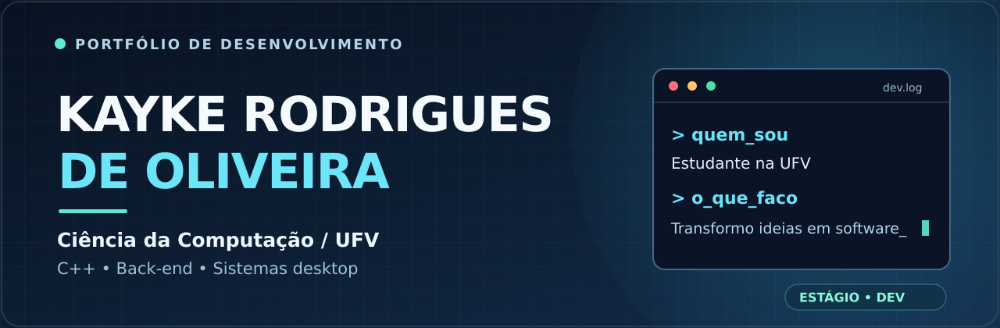
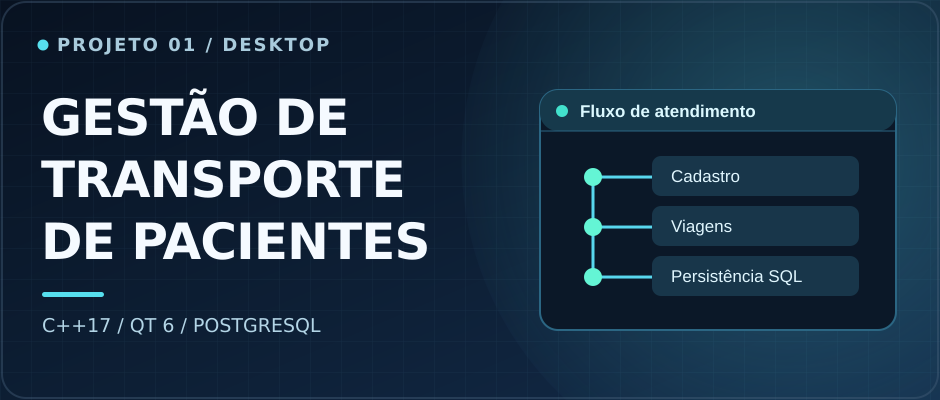
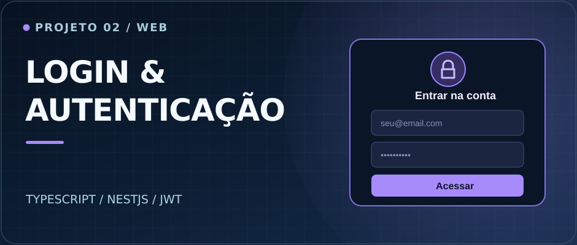
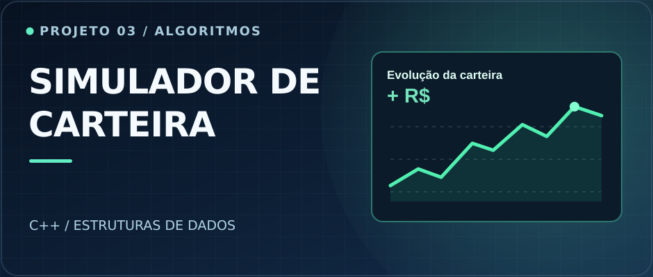
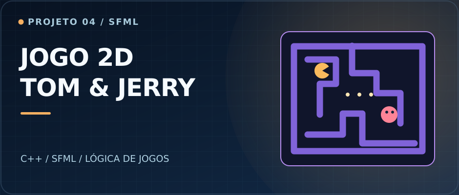

 

**Desenvolvendo aplicações que conectam interfaces, lógica de negócio e dados.**

---

### 👋 Sobre mim

Sou estudante de **Ciência da Computação na Universidade Federal de Viçosa (UFV)**, com interesse em desenvolvimento de software, back-end e aplicações desktop.

Desenvolvi uma solução para a **gestão do transporte de pacientes da Prefeitura de Piranga (MG)**, utilizando **C++17, Qt e PostgreSQL**. Também construo aplicações web com **TypeScript e NestJS** e atuo como **monitor de Introdução à Programação (INF100/INF101)** na UFV.

> 🎯 **Objetivo profissional:** estágio em desenvolvimento de software, em equipes nas quais eu possa aprender, colaborar e contribuir com produtos reais.

### ✦ Projetos selecionados

<table>
  <tr>
    <td width="50%" valign="top">
      
      <h3>🏥 Gestão de Transporte de Pacientes</h3>
      
Sistema desktop para organização de cadastros e viagens, com interface em Qt e persistência em PostgreSQL. Desenvolvido para o contexto da Prefeitura de Piranga (MG).

      
<code>C++17</code> <code>Qt 6</code> <code>PostgreSQL</code> <code>libpqxx</code>

      <a href="https://github.com/Kayke-Oli/Projeto-transporte-Prefeitura-Piranga"><b>Explorar repositório ↗</b></a>
    </td>
    <td width="50%" valign="top">
      
      <h3>🔐 Login e Autenticação</h3>
      
Aplicação web com cadastro de usuários, login, gerenciamento de perfil e autenticação JWT, combinando API e interface.

      
<code>TypeScript</code> <code>NestJS</code> <code>JWT</code> <code>Supabase</code>

      <a href="https://github.com/Kayke-Oli/Sistema-de-Login"><b>Explorar repositório ↗</b></a>
    </td>
  </tr>
  <tr>
    <td width="50%" valign="top">
      
      <h3>📈 Simulador de Carteira</h3>
      
Simulador financeiro em C++, com consultas de cotações, dividendos e operações. Implementa estruturas de dados e algoritmos sem utilizar contêineres prontos da STL.

      
<code>C++</code> <code>Estruturas de dados</code> <code>Algoritmos</code>

      <a href="https://github.com/Kayke-Oli/Banco-de-Dados-de-A-es---Simulador-de-Carteira"><b>Explorar repositório ↗</b></a>
    </td>
    <td width="50%" valign="top">
      
      <h3>🎮 Jogo 2D — Tom & Jerry</h3>
      
Jogo desenvolvido em C++ com SFML, incluindo movimentação em grade, colisões, estados de personagens e comportamento básico de inimigos.

      
<code>C++</code> <code>SFML</code> <code>Lógica de jogos</code>

      <a href="https://github.com/Kayke-Oli/Tom-and-Jerry-game-inspired-by-Pac-Man"><b>Explorar repositório ↗</b></a>
    </td>
  </tr>
</table>

As imagens acima são artes ilustrativas dos projetos, não capturas de tela das aplicações.

### ⚙️ Stack de desenvolvimento

**Linguagens**

**Frameworks, bibliotecas e dados**

**Ferramentas**

### 🎓 Experiência & formação

| | |
| :-- | :-- |
| **Monitoria • UFV** | **Abr/2026 — atual** Apoio nas disciplinas INF100/INF101, com orientação em lógica e fundamentos de programação. |
| **Ciência da Computação • UFV** | **Mar/2025 — conclusão prevista: Dez/2028** Bacharelado em andamento. |

---

### Vamos construir alguma coisa juntos?

Estou aberto a oportunidades de **estágio em desenvolvimento de software** e a conversas sobre projetos e tecnologia.

Desenvolvido com atenção ao detalhe — do código à apresentação.

